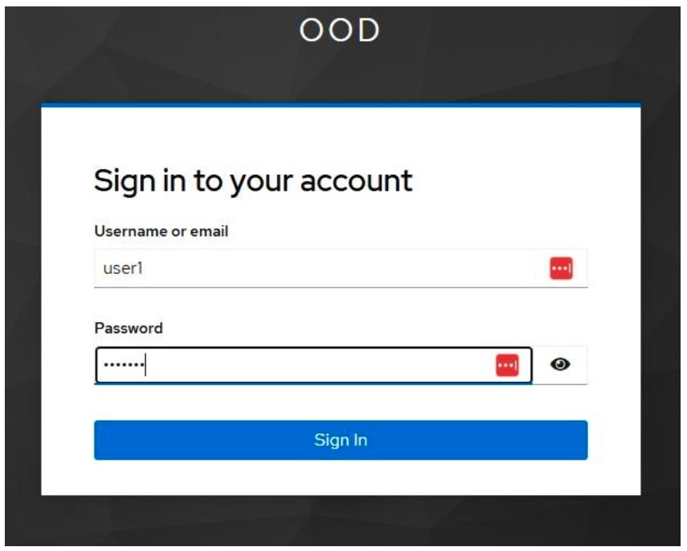
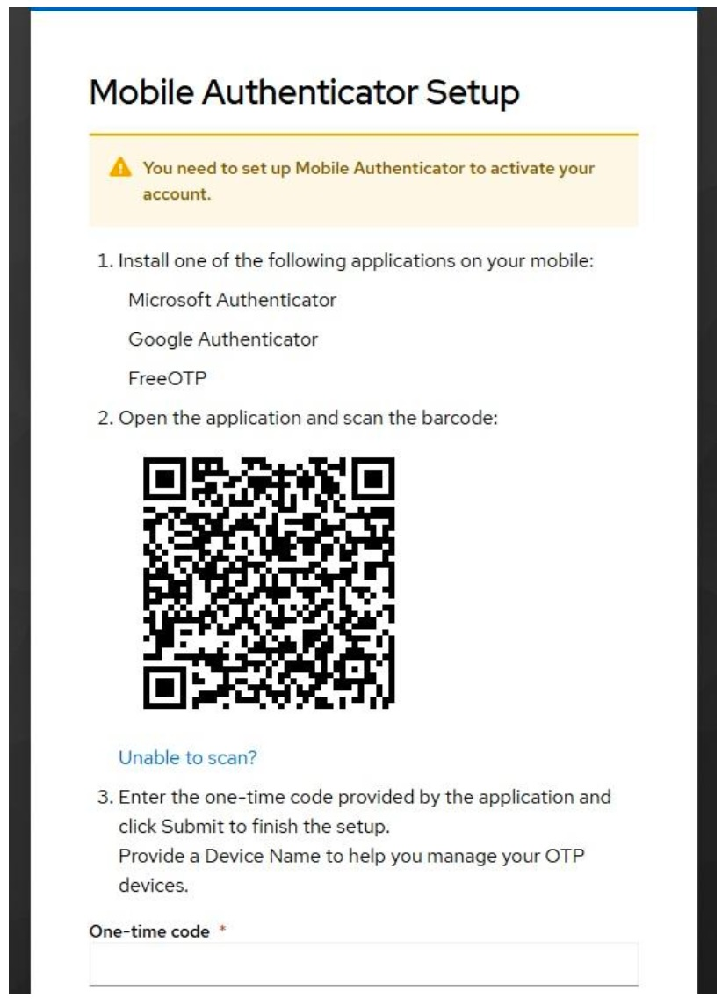
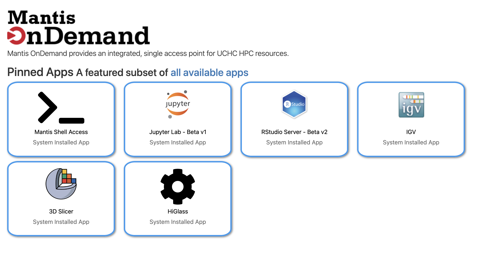

# HPC Setup

## Connecting to Mantis (UConn HPC)

Given UConn specific security requirements, access to `Mantis` (UCONN HPC) will be carried out through a special instance of Open OnDemand. [Open OnDemand](https://www.openondemand.org/) allows remote access to `Mantis` resources via a web browser. Some key resources are available in the form of “apps”. Acces via Open OnDemand requires 2-factor authentication with an Authenticator app. Several apps are suitable, including:

- Google Authenticator
- Microsoft Authenticator
- FreeOTP

Once configured these apps generate time-based one-time passwords (TOTP) as a second form of authentication in addition to your user ID and password (which will be sent directly to each participant via email).


To log in with a course account, visit https://learn.hpc.cam.uchc.edu and enter the user ID and password assigned to you:





Upon initial login you will be presented with the Mobile Authenticator Setup message with instructions to configure your OTP device.

Follow the instructions, retrieve the code from the OTP application you have chosen. Enter the code in the One-time code field and click “Submit”. You will be logged into the Mantis Open OnDemand portal.




Once you are logged-in you'll see something like this:





- You can start a `Mantis Shell Access`. Once there you can request resources for an interactive session, which is what we will be using for most of the workshop.

- You can start an interactive session like it is shown below, the important part is that you use specify the QoS (Quality of service) as interactive (`--qos=interactive`). 

```
srun -p general --qos=interactive -c 1 --mem=1G --pty bash
```

> **IMPORTANT** ‼️
> The  QoS (interactive) can optionally be used for starting  interactive jobs which will give the job a higher priority in the queue. This QOS has the following limits:
>   - 1 concurrent job
>   - no more than 8 CPUs
>   - no more than 64 GB memory
>   - no more than 8 hours of wall time


