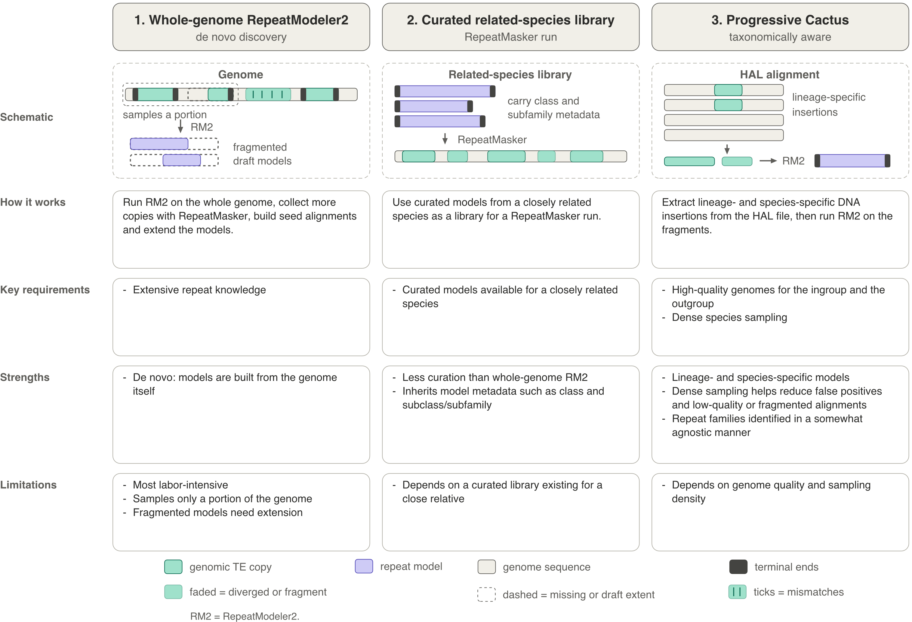
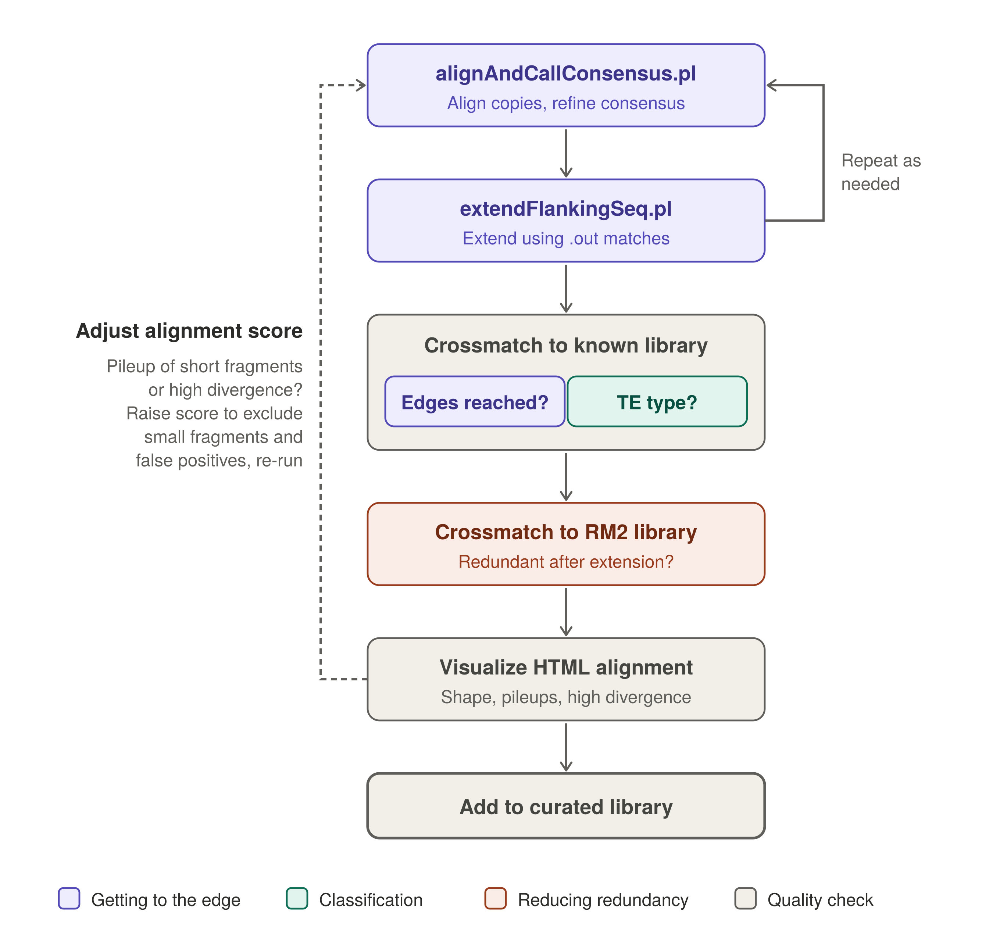

# Repeat curation workshop 2026

This GitHub repository is dedicated to materials related to the workshop: 

[Curating transposable element libraries for non-model organisms and assembling through the hard stuff](https://cba.anu.edu.au/news-events/events/curating-transposable-element-libraries-non-model-organisms-and-assembling)

- Occurring: 
  - 17 Nov 2026 9:30am - 18 Nov 2026 4:00pm
- In person
- Location:
  - Jan Anderson Seminar Room (ground floor), Research School of Biology, Australian National University, Canberra.

## Table of Contents
- [Workshop agenda](#Workshop-Agenda)
- [Repeat discovery pipeline](#Repeat-Pipeline)
  - [Figure 1: TE curation method comparison](#figure-1)
  - [Figure 2: TE pipeline from discovery to curation](#figure-2)
  - [Figure 3: Detailed curation steps](#figure-3)
- [Programs](#Programs) 
  - [UCSC tools](#UCSC-tools)
  - [RepeatModeler2](#RepeatModeler2)
  - [RepeatMasker](#RepeatMasker)

### Workshop Agenda

### Repeat Pipeline
<div align="justify">
<p>There are several methods that can be utilzed to curate repeat models (<b>Figure 1</b>). The first and most labor intensive is running RepeatModeler2 on the whole genome. This approach requires extensive repeat knowledge, samples only a portion of the genome, and extension of the models due to fragment discovery in the <i>de novo</i> process (<b>Figure 1, #1</b>). A second approach leverages curated models available for closely-related species, which are then used as a library for a RepeatMasker run (<b>Figure 1, #2</b>). This approach requires less curation than a whole-genome RM2 method. In addition, this method provides model metadata obtained from the curated model such as class and subclass/subfamily. Alternatively, Progressive CACTUS can be utilized to curate lineage- and species-specific models in a taxonomically-aware manner (<b>Figure 1, #3</b>). This process is made easier by the availability of high-quality genomes for the ingroup as well as the outgroup. In addition, a dense species sampling if there are high divergence times and/or low divergence times help alleviate the presence of false positives and low quality/fragmented alignments. The lineage- and/or species-specific DNA insertions can be extracted from the CACTUS alignment output (HAL file), and RepeatModeler2 run on the fragments in order to ascertain repeats families an a somewhat agnostic manner with the added benefit of a reduced search space. 

<div id="figure-1">
<p align="center">

</p>
</div>
<p align="center">
<b>Figure 1. TE curation method comparison</b> 
</p>

The general curation process that will be discussed in this workshop includes: repeat discovery (<i>de novo</i> <b>Figure 1, #1</b>), collecting TE instances/copies, generating a seed alignment, extending the putative models, ending with curation (<b>Figure 2</b>; <b>Figure 3</b>).

<div id="figure-2">
<p align="center">

</p>
</div>

<p align="center">
<b>Figure 2. TE workflow from discovery to curation</b>
</p>

<div id="figure-3">
<p align="center">

</p>
</div>

<p align="center">
<b>Figure 3. Detailed TE curation workflow</b>
</p>


## Programs

Below are the programs we will discuss as part of the workshop. For each program there is a short description as well as how it would be run on the command line.

### UCSC tools
The University of California, Santa Cruz (UCSC) has built a set of utilities for handling sequences and assemblies. The two programs are:
- faToTwoBit
- twoBitInfo

faToTwoBit converts a fasta file to a 2bit genome. While fasta files are a human-readable, plain-text format the 2bit format is a compact, binary-encoded format developed by the UCSC Genome Browser that encodes each DNA base using just 2 bits, vs 8 bits per character utilized by the fasta text format, cutting file size down by about 75%.

```
faToTwoBit <genome.fa> <genome.2bit> 
```

<genome.2bit> is a user-specified name.

twoBitInfo is used internally by <b>list programs here</b>, but can also be used on the command line:
```
twoBitInfo <genome.2bit> <genome.info> 
```
<genome.info> is a user-specified name, and is a plain text file that includes chromosome names and sizes. 

### RepeatModeler2
* Utilities

```generateSeedAlignments.pl``` - uses ```<model>.align``` files to build seed alignments. Seed alignments are multiple sequence alignments of TE copies that are categorized by the same model. This program is essential for generating the stockholm files necessary for downstream processes like Linup which are used to isolate the instances of this TE family. 
```
generateSeedAlignments.pl -taxon ${taxon} -assemblyFile ${assemblyFile.2bit} ${alignFile.align}
```


```Linup``` - uses stockholm files to isolate (1) the consensus for the given TE model and (2) isolates fasta sequences for every instance of that TE copy into one fasta file. These products are then used to refine consensus calling of this TE family 
```
Linup ${infile.stk} -consensus > ${prefix}.con.fa
Linup ${infile.stk} -fasta > ${prefix}.elements.fa
```


```alignAndCallConsensus.pl``` - Aptly named, this tool aligns a putative TE family consensus to all the instances of that family in your genome. Alignments generated from this step are used to call a consensus. This step can be run iteratively to continue refining the consensus as more sequences are considered during extension via H-pads, a set of Hs at the flank(s) you want to extend.
```
alignAndCallConsensus.pl -c <model-extended.con.fa> -e <model-extended_rename.elements.fa> -ma 14 -ht -re
```
- ```-c``` = consensus file
- ```-e``` = elements file
- ```-ma``` is the matrix value, the higher the matrix value the more divergence you are allowing for
  - can choose from these values: ```14,18,20,25```
- ```-ht```  creates an html file for easier visualization of the models and instances 
- ```-re``` tells the tool to iterate, default is 5 iterations but an integer can be specified for more or less iterations  
- a useful command might be ```-ms``` which stands for minimum score, if there are a lot of alignments with low scores they may interfere with the contiguity of the aligned models 
- in order to tell this tool to extend, H-pads need to be added - if extension is warranted at **BOTH* 5' and 3' end, ```-hp```  can be used which adds a user-specified number of H's to both ends of the consensus 


```rmblast.pl``` - RepeatMasker's version of NCBI-BLAST paired with cross_match sensitivity. It leverages scoring logic from cross_match to reflect the complexity and accuracy of target sequences. It is used to identify similar repeat sequences in the genome and can be used to compare repeat models to existing curated libraries.
```
rmblast.pl <model-extended.con.fa> <model-extended.con.fa>
```
- this command by itself will print alignment matches with less than 80% overlap
- use ```-masklevel 101``` to print all alignment hits
- ```-ms``` to filter out low scoring regions
- ```-a``` to print out the alignment(s)


```AutoRunBlocker.pl``` - Due to the nature of aligning instances that vary in divergence, there is occasionally evidence of insertions or deletions within the called consensus. In order to assess if those variants are part of the consensus, this tool identifies gaps or regions of lower similarity. It analyzes the consensus sequences and instances in windows to correct for these low confidence regions.
```
AutoRunBlocker.pl -l <model>.ali -w <window size> -mc 50 -p -mr 0.3
```
- ```-l``` = alignment file
- ```-w``` is the window size, this may be tuned depending on the size of the consensus sequence that is being investigated 
- ```-mc```  is minimum copy agreement, how many copies need to be the same in these windows for a change to be committed 
- ```-p``` = prompt, this is used to interact with the program in real time to accept or deny proposed changes 
- ```-mr``` = minimum ratio agreement, should not be less than 0.3
    
### RepeatMasker
* Utilities
  - buildSummary.pl
  - calcDivergenceFromAlign.pl
  - createRepeatLandscape.pl

### RepeatAfterMe
