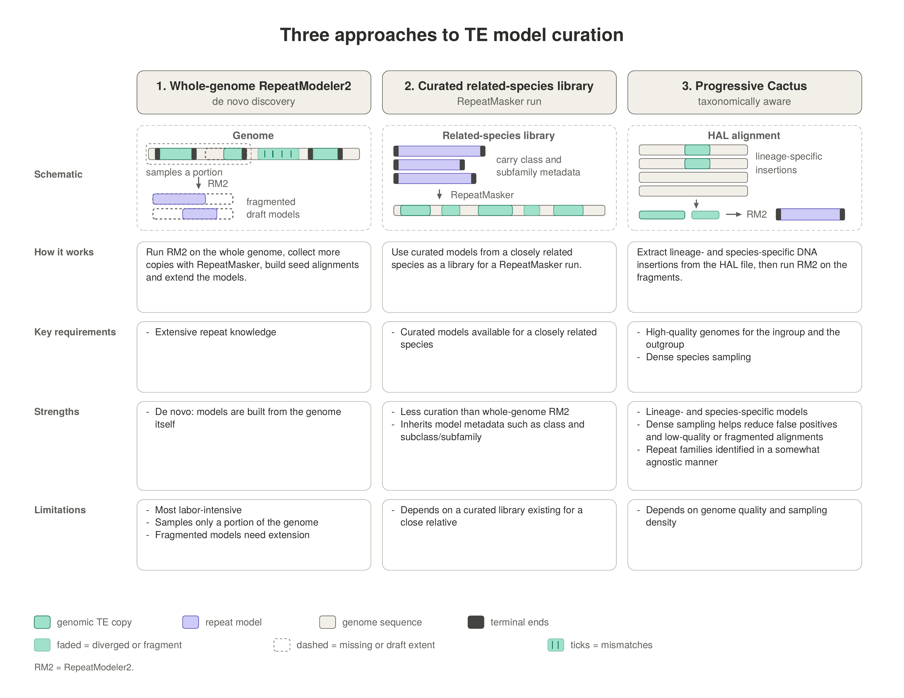
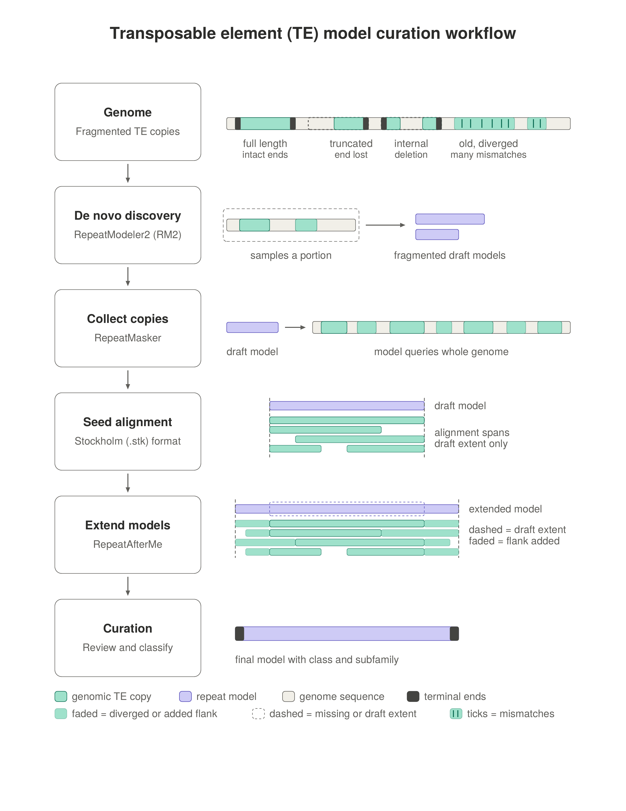

# Repeat curation workshop 2026

This GitHub repository is dedicated to materials related to the workshop: 

[Curating transposable element libraries for non-model organisms and assembling through the hard stuff](https://cba.anu.edu.au/news-events/events/curating-transposable-element-libraries-non-model-organisms-and-assembling)

- Occurring: 
  - 17 Nov 2026 9:30am - 18 Nov 2026 4:00pm
- In person
- Location:
  - Jan Anderson Seminar Room (ground floor), Research School of Biology, Australian National University, Canberra.

### Repeat Pipeline

There are several methods that can be utilzed to curate repeat models. The first and most labor intensive is running RepeatModeler2 on the whole genome. This approach requires extensive repeat knowledge, samples only a portion of the genome, and extension of the models due to fragment discovery in the <i>de novo</i> process. A second approach leverages curated models available for closely-related species, which are then used as a library for a RepeatMasker run. This approach requires less curation than a whole-genome RM2 method. In addition, this method provides model metadata obtained from the curated model such as class and subclass/subfamily. Alternatively, Progressive CACTUS can be utilized to curate lineage- and species-specific models in a taxonomically-aware manner. This process is made easier by the availability of high-quality genomes for the ingroup as well as the outgroup. In addition, a dense species sampling if there are high divergence times and/or low divergence times help alleviate the presence of false positives and low quality/fragmented alignments. The lineage- and/or species-specific DNA insertions can be extracted from the CACTUS alignment output (HAL file), and RepeatModeler2 run on the fragments in order to ascertain repeats families an a somewhat agnostic manner. 

For any of the pipelines, it is crucial to compare the models to existing libraries (if available) to reduce redundancy where possible.  
  
Subsequent steps include generating a stockholm (.stk) file and extension via RepeatAfterMe (RAM)..

1. Run RepeatMasker with curated library of a closely-related species
2. Generate .stk (Stockholm alignment file) of each of the models
3. Extend models using RepeatAfterMe (RAM)

## Programs

### UCSC tools
- faToTwoBit
- twoBitInfo

### RepeatModeler2
* Utilities
  - rmblastn.pl
  - alignAndCallConsensus.pl
  - AutoRunBlocker.pl
  - generateSeedAlignments.pl
    
### RepeatMasker
* Utilities
  - buildSummary.pl
  - calcDivergenceFromAlign.pl
  - createRepeatLandscape.pl

### RepeatAfterMe
