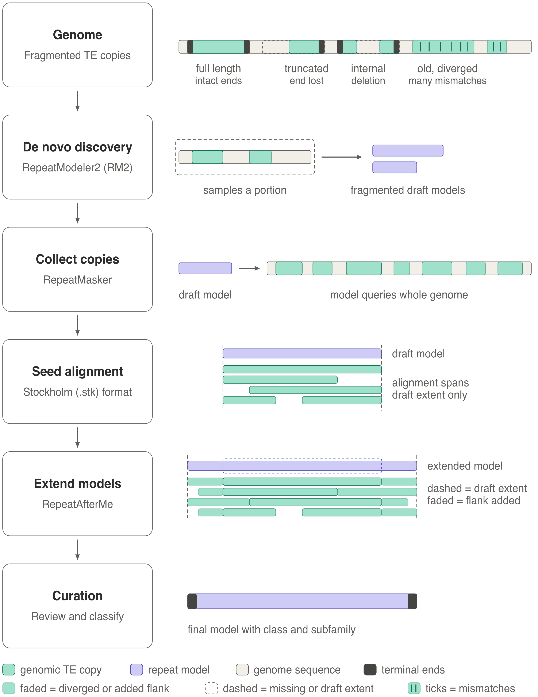

### Repeat Pipeline

There are several methods that can be utilzed to curate repeat models (<b>Figure 1</b>). The first and most labor intensive is running RepeatModeler2 on the whole genome. This approach requires extensive repeat knowledge, samples only a portion of the genome, and extension of the models due to fragment discovery in the <i>de novo</i> process (<b>Figure 1, #1</b>). A second approach leverages curated models available for closely-related species, which are then used as a library for a RepeatMasker run (<b>Figure 1, #2</b>). This approach requires less curation than a whole-genome RM2 method. In addition, this method provides model metadata obtained from the curated model such as class and subclass/subfamily. Alternatively, Progressive CACTUS can be utilized to curate lineage- and species-specific models in a taxonomically-aware manner (<b>Figure 1, #3</b>). This process is made easier by the availability of high-quality genomes for the ingroup as well as the outgroup. In addition, a dense species sampling if there are high divergence times and/or low divergence times help alleviate the presence of false positives and low quality/fragmented alignments. The lineage- and/or species-specific DNA insertions can be extracted from the CACTUS alignment output (HAL file), and RepeatModeler2 run on the fragments in order to ascertain repeats families an a somewhat agnostic manner with the added benefit of a reduced search space. 

<b>Figure 1. TE curation method comparison</b> 

The general curation process that will be discussed in this workshop includes: repeat discovery (<i>de novo</i> <b>Figure 1, #1</b>), collecting TE instances/copies, generating a seed alignment, extending the putative models, ending with curation (<b>Figure 2</b>; <b>Figure 3</b>).

<b>Figure 2. TE workflow from discovery to curation</b>

<b>Figure 3. Detailed TE curation workflow</b>

