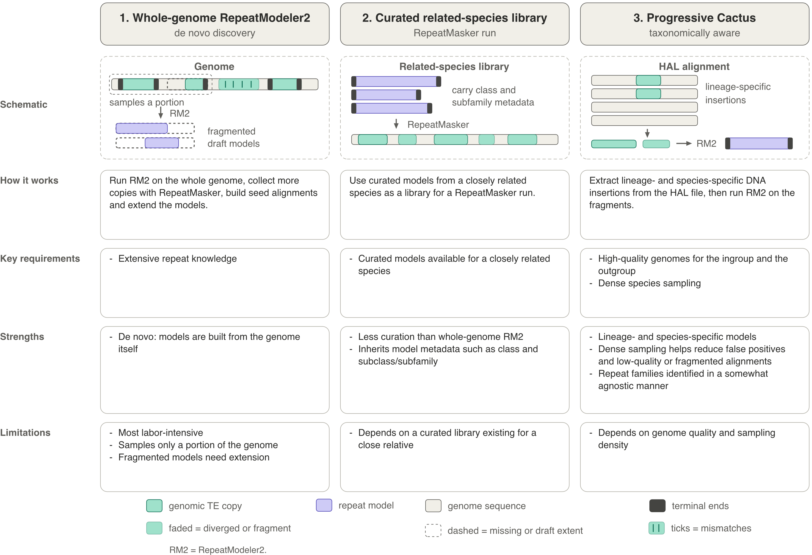
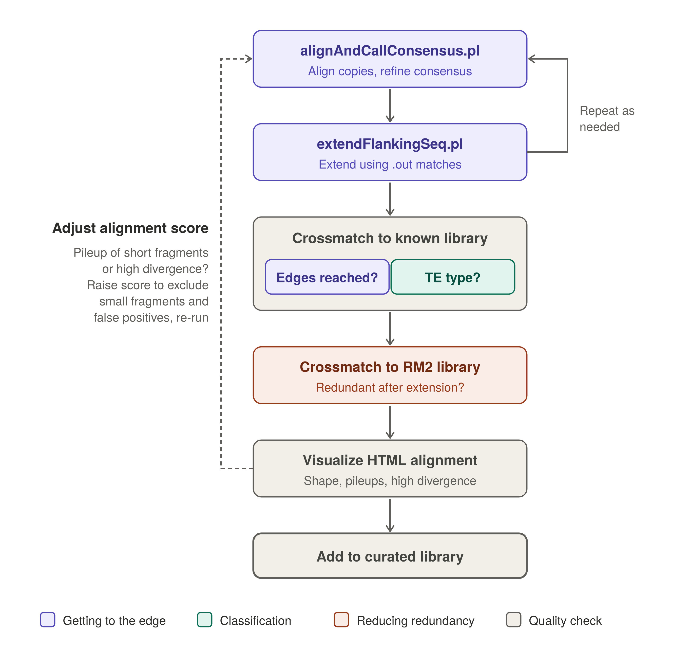
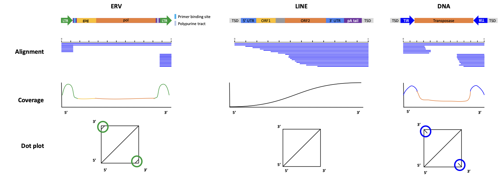

# Table of contents
- [Repeat discovery pipeline](#Repeat-Pipeline)
  - [Figure 1: TE curation method comparison](#figure-1)
  - [Figure 2: TE pipeline from discovery to curation](#figure-2)
  - [Figure 3: Detailed curation steps](#figure-3)
  
## Repeat Pipeline
<div align="justify">
<p>There are several methods that can be utilzed to curate repeat models (<b>Figure 1</b>). The first and most labor intensive is running RepeatModeler2 on the whole genome. This approach requires extensive repeat knowledge, samples only a portion of the genome, and extension of the models due to fragment discovery in the <i>de novo</i> process (<b>Figure 1, #1</b>). A second approach leverages curated models available for closely-related species, which are then used as a library for a RepeatMasker run (<b>Figure 1, #2</b>). This approach requires less curation than a whole-genome RM2 method. In addition, this method provides model metadata obtained from the curated model such as class and subclass/subfamily. Alternatively, Progressive CACTUS can be utilized to curate lineage- and species-specific models in a taxonomically-aware manner (<b>Figure 1, #3</b>). This process is made easier by the availability of high-quality genomes for the ingroup as well as the outgroup. In addition, a dense species sampling if there are high divergence times and/or low divergence times help alleviate the presence of false positives and low quality/fragmented alignments. The lineage- and/or species-specific DNA insertions can be extracted from the CACTUS alignment output (HAL file), and RepeatModeler2 run on the fragments in order to ascertain repeats families an a somewhat agnostic manner with the added benefit of a reduced search space. 

<div id="figure-1">
<p align="center">

</p>
</div>
<p align="center">
<b>Figure 1. TE curation method comparison</b> 
</p>
<br>

The general curation process that will be discussed in this workshop includes: repeat discovery (<i>de novo</i> <b>Figure 1, #1</b>), collecting TE instances/copies, generating a seed alignment, extending the putative models, ending with curation (<b>Figure 2</b>; <b>Figure 3</b>).

<div id="figure-2">
<p align="center">

</p>
</div>

<p align="center">
<b>Figure 2. TE workflow from discovery to curation</b>
</p>
<br>

Curation is an iterative process (<b>Figure 3</b>), as you begin to investigate models you may need to jump back and forth between various tools and platforms. The most common approach is starting with ```alignAndCallConsensus.pl```, which will output an HTML file. This HTML may guide you in deciding if extension is needed, trimming (ex: segmental duplication), or if you have gotten to the edges of your model. You can use ```rmblast.pl``` which may help you gauge how much extension is needed to get close to the edges based on curated repeats from related species. Following extension or trimming, running ```alignAndCallConsensus.pl``` again will output an HTML (note: previous HTMLs will be overwritten), do the inspection process over until you’ve captured the edges of your model. 

<br>
As you make these decisions, here are some helpful tips(<b>Figure 3; Figure 4</b>):
- for ERVs
    - Use NCBIs blastx to check for domains
    - Dotplot visualization will show duplications 
- For DNA elements 
    - Dot plots will show inversions at the edges 
- LINEs and SINEs
    - HTML and ``rmblast.pl``` to curated models is helpful here 
    - looking for polyA tail at the 3' end

<div id="figure-3">
<p align="center">

</p>
</div>

<p align="center">
<b>Figure 3. Detailed TE curation workflow</b>
</p>
<br>

Visualizing potential models is essential to ascertain if a TE model is complete. In addition, the combination of several visualization methods can also help determine the TE type (<b>Figure 4</b>):

- Endogenous retroviruses (ERVs): For example, a byproduct of ERV non-homologous recombination events are solo long terminal repeats (soloLTRs). Given this information, it is expected that there will be many shorter alignments to the LTR portion of the ERV, with much higher coverage in these regions. In addition, a self-alignment, visualized in the form of a dot plot, displays the LTRs of an ERV. The contiguity of the dot plot matches will also allow the researcher to identify if the ERV belongs to an older family, as the 5’ and 3’ LTRs are more likely to be diverged from one another.
- LINE: LINE element will display a 5’ truncation pattern in the alignment, which will also be reflected in the coverage over the LINE element.
- DNA TEs : For DNA elements, due to the transposition mechanism, the internal deletions of the autonomous element are common, and are more abundant. In addition, the overall divergence of the alignment will be lower. In contrast to ERVs, the 5’ and 3’ terminal coverage will extend past the terminal inverted repeats (TIRs) and into the internal portion of the element.

For the examples above, it is important to note that the actual divergence and quality of alignment to the consensus will vary. In addition, this is merely a small example of well-studied families to highlight the strength of the patterns available in order to aid in TE curation. The use of these patterns can also aid in troubleshooting during the curation process.

<div id="figure-4">
<p align="center">

</p>
</div>

<p align="center">
<b>Figure 4. TE curation visualization overview </b>
</p>


