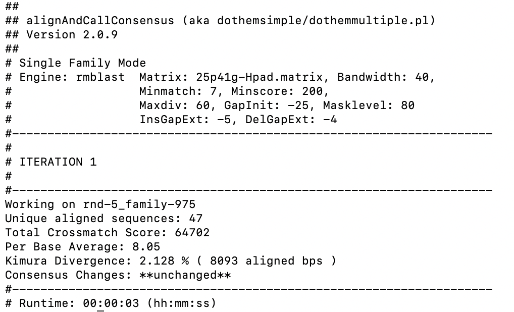

# Testing your container installation

To test the container, please run the following test (using the `rnd-5_family-975-extended.con.fa` files `rnd-5_family-975-extended_rename.elements.fa` in this directory):

1. Activate the `TETools` container

```
/path/to/container/dfam-tetools.sh
```

2. Run alignAndCallConsensus.pl program

```
/opt/RepeatModeler/util/alignAndCallConsensus.pl -c rnd-5_family-975-extended.con.fa -e rnd-5_family-975-extended_rename.elements.fa
```

If your test is successful, you will see the following on your terminal:

<p align="center">

</p>
<p align="center">


and the following files will be produced:

```
rnd-5_family-975.out
rnd-5_family-975.ali
rnd-5_family-975.out.CGmodified
```
